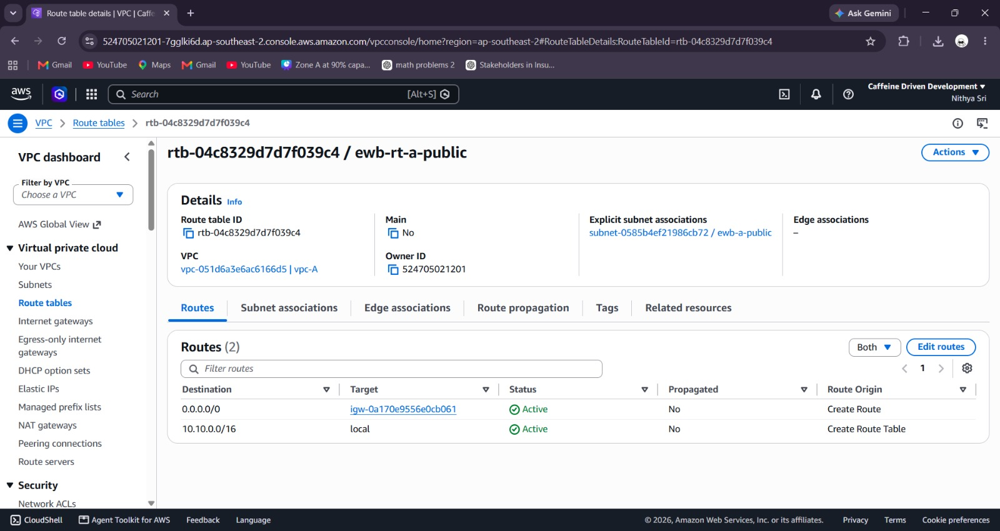
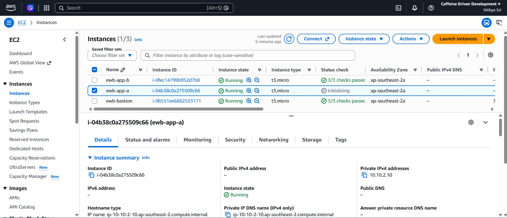
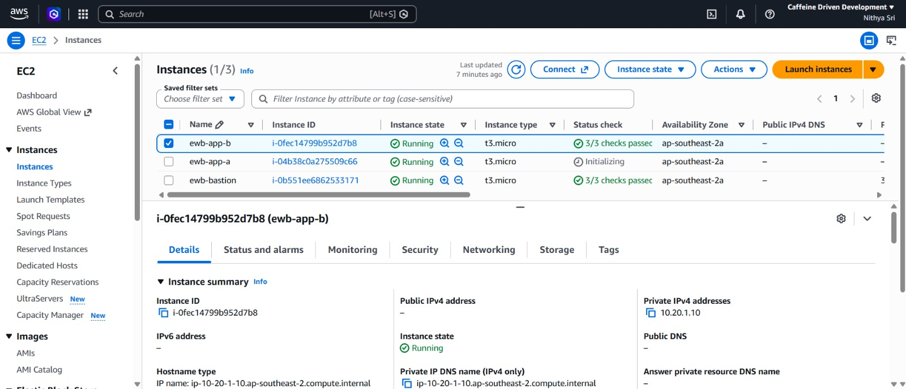
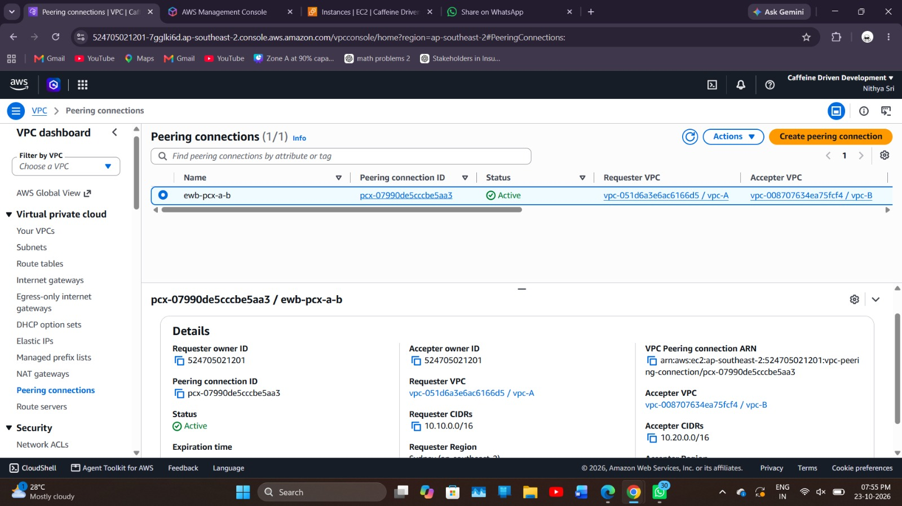
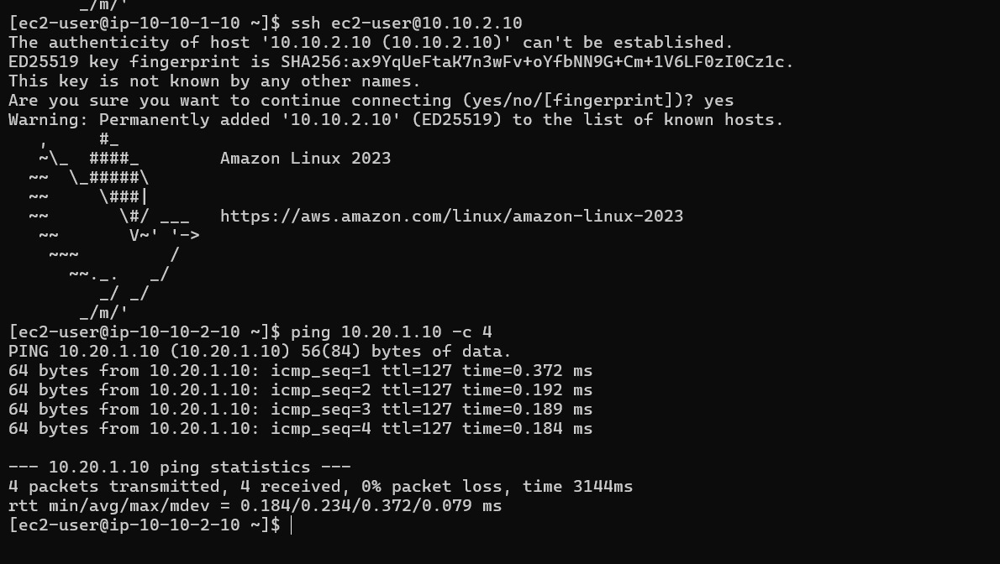

# AWS Multi-VPC Peering & Secure Cross-VPC Architecture

An enterprise-grade AWS multi-VPC networking lab demonstrating secure private cross-VPC communication, jump-host perimeter defense, and non-overlapping CIDR routing.

---

## 📐 Architecture Overview

- **Primary VPC (VPC A):** `10.10.0.0/16`
  - Public Subnet (`ewb-a-public`): `10.10.1.0/24` in `ap-southeast-2a`
  - Private Subnet (`ewb-a-private`): `10.10.2.0/24` in `ap-southeast-2a`
- **Peered Target VPC (VPC B):** `10.20.0.0/16`
  - Private Subnet (`ewb-b-private`): `10.20.1.0/24` in `ap-southeast-2a`
- **Jump Host Perimeter:** Public Bastion server (`10.10.1.10`) running in `VPC A`.
- **Private Workloads:** `ewb-app-a` (`10.10.2.10`) and `ewb-app-b` (`10.20.1.10`) deployed with **no public IPv4 addresses assigned**.
- **Inter-VPC Peering:** Active AWS VPC Peering Connection (`ewb-pcx-a-b`) linking `VPC A` and `VPC B`.

---

## 🛠️ Infrastructure Allocation

| Component | Resource Name | VPC | Subnet / CIDR | IP Address |
| :--- | :--- | :--- | :--- | :--- |
| **VPC A** | `ewb-vpc-a` | `ewb-vpc-a` | `10.10.0.0/16` | Primary VPC |
| **VPC B** | `ewb-vpc-b` | `ewb-vpc-b` | `10.20.0.0/16` | Peered Target VPC |
| **Bastion Host** | `ewb-bastion` | `ewb-vpc-a` | `10.10.1.0/24` | Public: Auto-assigned / Private: `10.10.1.10` |
| **App Instance A** | `ewb-app-a` | `ewb-vpc-a` | `10.10.2.0/24` | Private IP: `10.10.2.10` (No Public IP) |
| **App Instance B** | `ewb-app-b` | `ewb-vpc-b` | `10.20.1.0/24` | Private IP: `10.20.1.10` (No Public IP) |
| **VPC Peering** | `ewb-pcx-a-b` | VPC A ↔ VPC B | N/A | Active Peering Link |

---

## 🔒 Key Security Implementation

1. **Zero Public Internet Exposure for Workloads:** `ewb-app-a` and `ewb-app-b` reside strictly in private subnets with auto-assign public IP disabled.
2. **Keyless Jump Host Transit:** Utilized SSH Agent Forwarding (`ssh -A`) from local machine to transit through `ewb-bastion` into `ewb-app-a` without storing private key files (`.pem`) on cloud hosts.
3. **Granular Least-Privilege Security Groups:**
   - Inbound SSH restricted strictly to the Bastion host (`10.10.1.10/32`).
   - Inbound Custom ICMP (ping) restricted strictly to peer private IPs (`10.20.1.10/32` and `10.10.2.10/32`).

---

## 📸 Verification Checkpoints

### 1. Public Route Table & Internet Gateway Routing
Public route table (`ewb-rt-a-public`) associated with `ewb-a-public` subnet, routing `0.0.0.0/0` traffic to Internet Gateway `ewb-igw-a`.

### 2. Private Workload Isolation
Verification that `ewb-app-a` (`10.10.2.10`) and `ewb-app-b` (`10.20.1.10`) have zero public IPv4 assignments.

  
  

### 3. Active VPC Peering Connection
Active peering connection `ewb-pcx-a-b` bridging `10.10.0.0/16` and `10.20.0.0/16`.

### 4. End-to-End Cross-VPC Connectivity Testing
Verification of SSH Agent Forwarding jump login to `ewb-app-a` (`10.10.2.10`) and successful ICMP echo request (`ping 10.20.1.10 -c 4`) across the peering link with **0% packet loss**.
